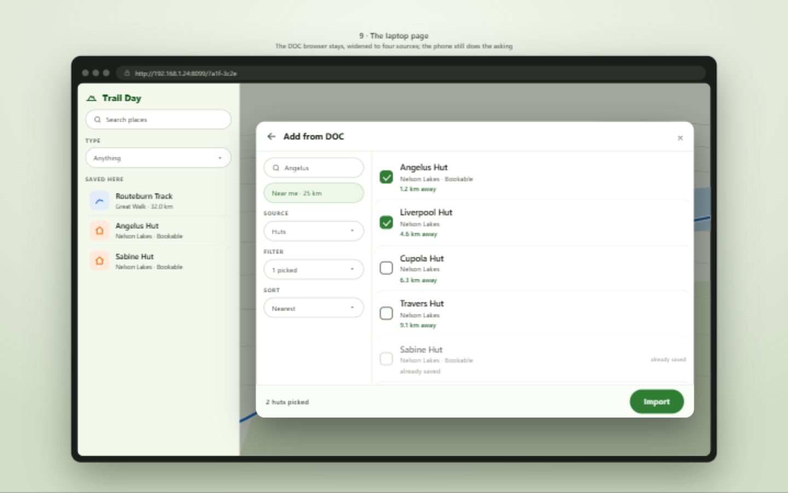
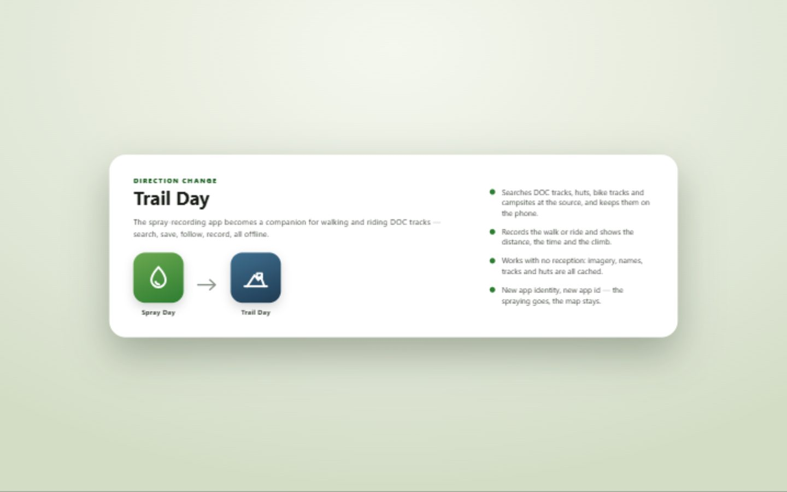
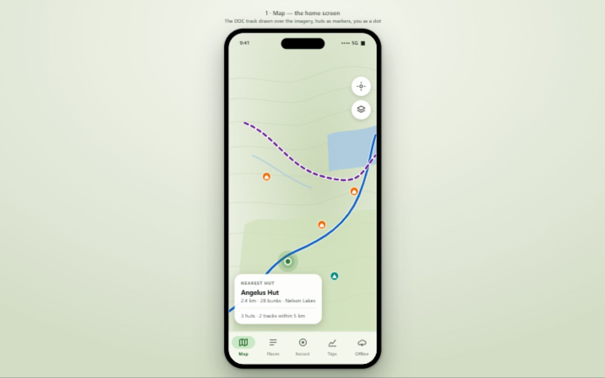
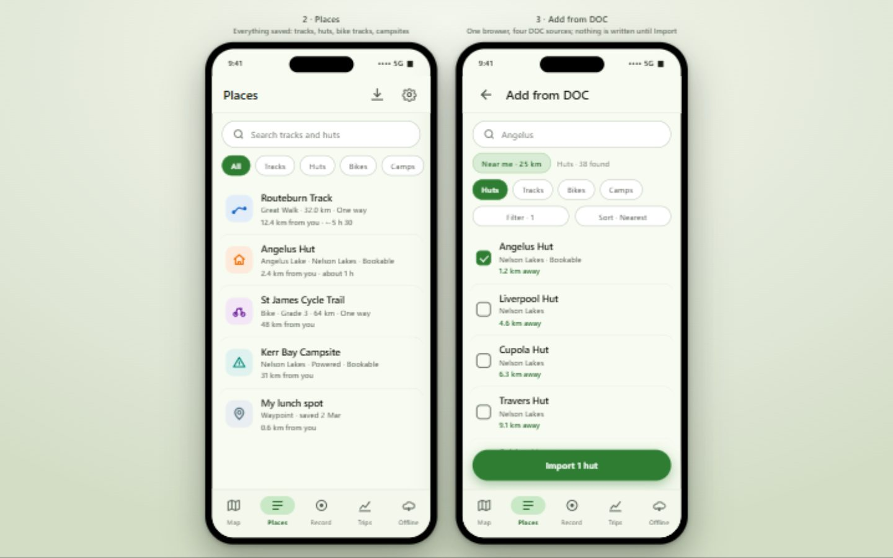
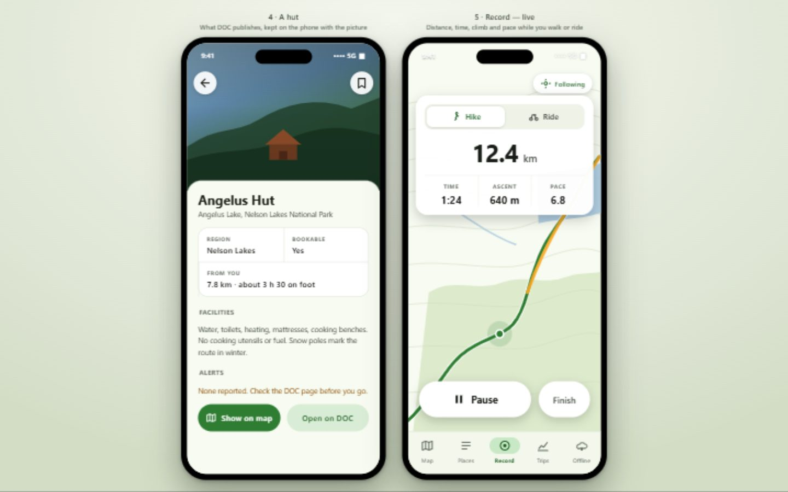
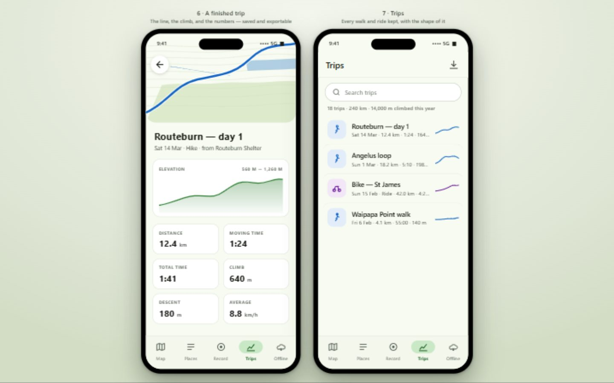
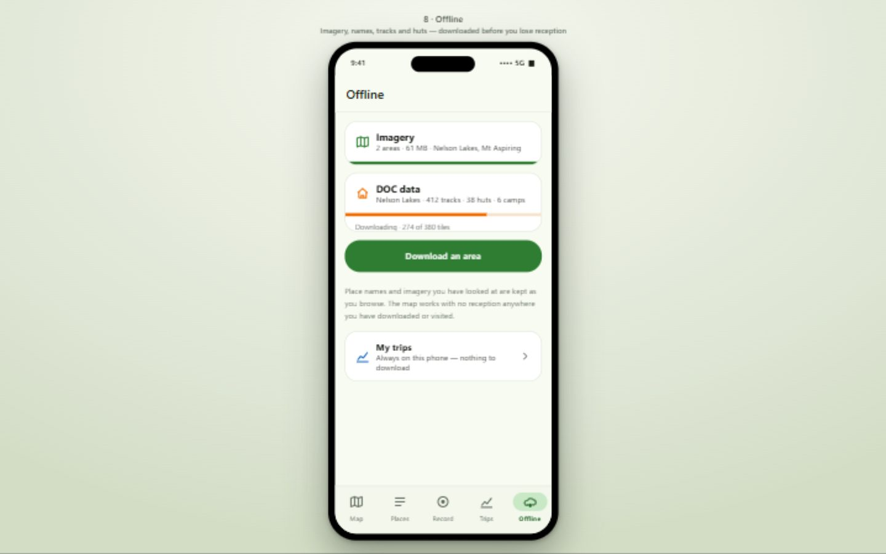

# Trail Day — from spray records to DOC tracks and huts

The app's direction changes: it stops being a spray-recording tool and becomes a companion for
people walking and riding the New Zealand backcountry — find a DOC track or hut, keep it, follow it
with no reception, record the trip, and keep the record of it.

The app is called **Trail Day**.

## Why this is a conversion rather than a new app

Most of what makes this app good has nothing to do with spraying:

- the map — LINZ aerial imagery and OpenStreetMap, place names over the imagery, the phone's own dot;
- the **offline tile server**, which is what makes the map work with no reception;
- the **DOC browser**, already reading DOC's published track service and caching an area's tracks;
- the **recording engine** — a foreground service writing every fix, pauses written down as pauses;
- **elevation** — heights kept on a track and drawn as a profile;
- track interchange — GPX, KML, KMZ and GeoJSON in and out, and side tracks;
- backing up, off-site copies, and updating from inside the app.

What is specific to spraying is the layer on top: spray records, products, swath widths, passes,
blocks, due dates and their reminders, the traffic light, and the handover sheet. That layer comes
off. What it leaves behind is a map-and-tracks app that happens to be aimed at a farmer, and the aim
is what changes.

So: **keep the codebase and the architecture; change the subject.** A fresh app id and a fresh
database, so nothing of the spraying is carried into the new one.

## What it becomes

Five tabs, the same five shapes the app already has:

| Tab | Was | Becomes |
| --- | --- | --- |
| **Map** | assets coloured by when they are due | tracks, huts, campsites and your own waypoints over the imagery |
| **Places** | the spray assets | the tracks and huts you have saved |
| **Record** | a spray pass, with coverage of a planned line | a walk or a ride, with distance, time, climb and pace |
| **Trips** | recordings as evidence for a spray | the walks and rides you have done |
| **Offline** | imagery and DOC tracks | imagery, names and **all** DOC data — tracks, huts, campsites, bike locations |

Everything else — a drawn track, one place, a download area, settings — is opened from one of those
and is not a tab, exactly as now.

## What is kept

Nothing here needs to be rebuilt; it needs to be renamed and re-aimed at most.

| Kept | Where it is | What changes |
| --- | --- | --- |
| Basemaps, tile server, offline imagery, tile cache | `domain/tiles/`, `offline/` | nothing but the wording |
| Place names over the imagery (LINZ) | `domain/tiles/PlaceLabels.kt` | nothing — more valuable to a hiker than to a sprayer |
| Letter shapes served to both maps | `assets/fonts/` | nothing |
| Geometry: lines, rings, side tracks, lengths | `domain/geo/`, `domain/asset/AssetGeometry.kt` | keeps side tracks; drops the spray-only readings |
| Elevation: kept heights, range, profile chart | `domain/geo/ElevationProfile.kt`, `ElevationChart.kt` | becomes a headline feature, not a footnote |
| GPX / KML / KMZ / GeoJSON in and out | `domain/track/` | nothing |
| The map: layers, layer switches, tap-to-open, hit test, marker glyphs | `map/` | new kinds and colours, same machinery |
| GPS recording: foreground service, fixes, pauses | `tracking/`, `data/db/RecordingEntities.kt` | reframed and extended with trip statistics |
| Backups, off-site copies, updates from inside the app | `backup/`, `update/` | new repository and file names |
| Settings skeleton, DataStore | `data/SettingsRepository.kt`, `ui/screens/SettingsScreen.kt` | the LINZ key stays; the products and spray switches go |
| The laptop editor | `web/` | keeps the map, the tracks and the DOC browser |

## What goes

The whole spraying layer, and with it several screens:

- **Spray records** — `SprayEventEntity`, `SprayEventDao`, `SprayRepository`, `SprayEntryScreen`,
  `SprayEntryViewModel`, and the history on a place's card.
- **The product catalogue** — `ProductEntity`, `ProductDao`, and the tidy-up screen.
- **Spray method, swath width and passes** — `SprayMethod`, `MethodPhrase`, `PassPhrase`, the
  `method`, `swathWidthM`, `passesRequired` and `passSeparationM` columns, and the two-pass reading
  (`TwoPasses`, `TwoPassPhrase`).
- **Due dates and the traffic light** — `domain/due/`, the asset colour, the `intervalDays` and
  `lastSprayedAtEpochMs` columns, and the map's green/amber/red.
- **Reminders** — `reminders/`, `domain/reminders/`, and the "something is due" notification.
- **The handover spreadsheet** — `domain/handover/`, `HandoverRepository`.
- **Blocks** — `GroupEntity`, `GroupDao`, the blocks screens, `AssetGrouping`, `BlockEdits`.
- **Coverage of a planned line** — `Coverage`, `AssetCoverageStretches`, `RecordedPass` — which
  existed to say how much of a spray job a pass had done.
- **The farm's kinds** — `ROAD`, `FENCELINE`, `CARPARK`, `BUILDING`, `SIGN`, `BENCH`, `TABLE`,
  `POLE_GATE`, `OTHER_PLACE` and the stored word `INFRASTRUCTURE`.
- **Bulk edits** across many rows (`BulkAssetEdits`), and **farm statistics** (`FarmStats`), which
  become trip statistics.

The map, the geometry, the DOC reader and the recorder are all untouched by this list; that is the
point of doing it as a conversion.

## What is new

### Huts, campsites and bike locations

DOC publishes all of these as hosted web services, from the same organisation as the track service
the app already reads, so one read-and-cache path serves all four.

| Browser tab | Service | Geometry | Records | What a row shows |
| --- | --- | --- | --- | --- |
| **Tracks** | `DOC_Tracks_EAM` (already used) | lines | 3,255 | kind, track type, length, distance |
| **Huts** | `DOC_Huts` | points | 1,429 | place, region, whether bookable, distance |
| **Bikes** | `DOC_Mountain_Bike_Tracks` | points | — | difficulty (Easiest→Extreme), biking time, distance |
| **Campsites** | `DOC_Campsites` | points | — | category, powered/unpowered, free or bookable |

All four are under the same ArcGIS organisation the track service uses
(`services1.arcgis.com/3JjYDyG3oajxU6HO`), so the host is named once. Each is asked the same way the
tracks already are — `f=geojson&outSR=4326` — so ArcGIS reprojects from NZTM and the app reads
GeoJSON it already understands.

Three things worth knowing, read from the live services rather than assumed:

- **A hut carries its own place and region**, so the place-first naming the tracks needed (the app's
  own `FlocID` map, because DOC's tracks carry no place) is **not needed for huts, campsites or bike
  locations** — that map stays, for tracks only.
- **The bike layer is points, not lines.** It is the *location* of a track where biking is permitted,
  with a difficulty and an estimated time, not rideable geometry. So "Bikes" is a guide: find a track
  worth riding, read its difficulty, and open the line from the Tracks tab (or a GPX you import).
  Presenting it honestly as a location is the whole of the feature.
- **The huts layer publishes no bunk count.** It carries a free-text `facilities` line and a
  `bookable` flag, and the card shows those rather than a number DOC did not give. DOC says a
  replacement dataset is coming for these layers too, which is the same one-line change the tracks
  already allow for (`DocTracksUrl.SERVICE_URL` becomes a per-source URL).

A hut's `introductionThumbnail` is a picture on a DOC server; the app keeps it with the hut when the
area is cached, so a hut reads the same with no reception.

### The trip

The recorder already writes every fix to the database, keeps the height on each one, and writes a
pause down as a pause. Aimed at a walk or a ride, that is almost the whole feature — what is new is
the **reading** of it:

- live, on the recorder: distance, elapsed and moving time, climb, and pace (or speed for a ride);
- saved: the line on a small map, the elevation profile, and a grid of figures — distance, moving
  time, total time, climb, descent, average;
- a **Trips** list: every walk and ride, newest first, with a small profile beside each;
- **GPX out**, which the app already writes.

The two-pass and side-track machinery stays in the geometry (a track with a spur is a real thing on
the ground), but nothing about "how much of the job is done" survives.

### Saving a place, and a waypoint

Today the only things kept are spray assets. The new app keeps what a walker saves:

- a **documented track** imported from DOC or a file — a line;
- a **hut**, **campsite** or **bike location** imported from DOC — a point;
- a **waypoint** of your own — the lunch spot, the trailhead, the water — placed with a tap.

Imported DOC places are recognised by an exact reference (`sourceRef`), which already exists and
already travels in a backup, so a second search cannot save the same hut twice — the same rule the
tracks have.

## The DOC browser, generalised

The existing browser (`DocTracksScreen`, `DocTracksViewModel`, `DocTracksSource`, `DocTrackCache`)
becomes **one browser with a source**: a segmented control across the top picks Tracks, Huts, Bikes
or Campsites, and everything else is the same — a name field, **Near me** with a distance, labelled
**Filter** and **Sort** controls built from what the search actually returned, a tickable list, and
**Import**. The search still happens at DOC, so the phone asks for the few places you want rather
than all of them, and nothing is written until Import.

Under the screens, one name becomes four:

- `DocTrackQuery` → `DocQuery`, carrying the source and its `where`/out-fields;
- `ArcGisDocTracks` → `ArcGisDoc`, one reader for all four;
- `DocTrackCache` → `DocPlaceCache`, keyed by the source so a hut and a track with the same key
  cannot collide;
- the offline downloader (`DocTrackDownloader`) downloads every source in an area in one pass.

The same browser stands on the laptop page, where the phone still does the asking and the page never
reaches DOC itself — so the service stays named in one place however many surfaces read it.

## Offline

The offline story is already the app's best feature, and it gets more important here:

- **Imagery** — unchanged: downloaded areas, resumable, verified tile by tile.
- **Names** — unchanged: LINZ's place names are kept as they are looked at, so a downloaded area
  keeps its names.
- **DOC data** — the cache gains huts, campsites and bike locations beside the tracks, listed and
  cleared as one **DOC data** entry (they are one download even though they are four services).
- **A new convenience built on what is there**: **download the ground around a track**. Today the
  offline picker takes a box; for a walker the natural unit is *the track I am about to walk*, so
  offer "Download along this track", with a width either side and a zoom range, worked out from the
  track's own line — which is the existing `OfflineAreaPlan` and `TileDownloader` with a different
  source of corners.
- **Your trips are always on the phone** and need nothing downloaded.

## Identity and the app id

**Decided: a new app, under a new id, `nz.mckenzie.trailday`.** A clean install with a clean database
and the right name in the launcher; the old app is left where it is, so nothing is lost, and it can
be uninstalled once the new one is trusted. The one cost is the imagery already downloaded, which
describes areas chosen for spraying and can be fetched again.

The alternative — keeping `nz.mckenzie.sprayday` — was considered and set aside: it would update the
phone in place and keep its downloaded imagery, but it carries the spray database across, leaves the
old name in the launcher, and puts spraying screens under a name that no longer means anything.

A new id means a new repository and a new update feed (`cqrt/trail_day` rather than
`cqrt/spray_day`), and a first release of its own.

## Data and backups

- **The old spray data is not carried over.** Nothing in it is about tracks or huts, and a restore
  that half-read a spray file into a walking app would be worse than starting clean.
- **Backups start fresh**, with the same machinery — one JSON file, a restore that shows both sides
  before it replaces, and the off-site copy with the "an empty database is never written over the
  copy" rule unchanged.
- **DOC's data licence travels with it.** DOC data is CC-BY 4.0, Crown copyright, so any credit
  strip that draws a DOC layer names DOC, beside LINZ for the imagery and names.

## The laptop editor: the map, the tracks and the DOC browser

**Decided: keep a reduced version of the served page, with the DOC browser on it.** The page keeps
what a bigger screen is genuinely better at, and loses the spraying:

- **Kept** — the map, with the same tracks and huts over the same imagery and the phone's own
  figures; opening a track and tidying its line by hand; the search and the Type list, reworded to
  the new kinds; and **the DOC browser**, widened to the four sources exactly as it is on the phone,
  so a laptop can search DOC's tracks, huts, campsites and bike locations and import them.
- **Gone** — the spray record, the product catalogue, the block ideas, and the side-track editing
  that existed to describe a spray job.

The DOC browser on the page keeps its shape and its rule: it is a **dialog over the work**, the list
taking most of its width with the search and the controls in a column beside it, and **the phone
still does the asking** — the page calls the phone and the phone calls DOC — so the service stays
named in one place, the laptop never reaches it, and every result, distance and already-saved mark
comes from the phone.

The keep-awake-while-serving switch stays with the page, since the page still needs the phone awake
to serve it.

## The mock screens

These are drawn mock-ups, not screenshots of a running app; they exist to fix the shape of the thing
before any of it is built. The laptop page has its own picture, in the section above.

The mock-ups are built from one HTML file, `mockups/trail-day-mockups.html`, which can be opened in a
browser to look at any screen closely; the pictures above were taken from it.

## The plan

Ordered so the app opens and works at every step.

- [x] **New identity.** The package and app id `nz.mckenzie.trailday`, the root project name, the
      launcher name and icon, the database and the stores named after the app, the update feed and
      the user agents. The spraying still works; it is just wearing a new name.
      Proved by `assembleDebug testDebugUnitTest lint`, 217 connected tests, and the app opening as
      Trail Day with its new icon on the emulator — `build/verify/trail-day-identity.txt`. Two
      follow-ups: the repositories `cqrt/trail_day` and `cqrt/trail-day-backups` have to be created
      before a release or an off-site copy can go anywhere, and the README rewrite waits until the
      behaviour changes, so for now it carries a note at the top pointing here.
- [ ] **Take the spraying out.** Delete the screens and tables in *What goes* above, rework the kinds
      from `AssetKind` to a `PlaceKind` (Track, Bike track, Hut, Campsite, Waypoint), and turn the
      asset's card, list row and map colour to the new kinds. The app opens on the map with whatever
      DOC tracks have been imported, and nothing else.
- [ ] **Huts, campsites and bike locations.** Generalise the browser and the cache to four sources,
      add the three new place kinds with their own glyphs, and the hut's card — place, region,
      bookable, facilities, alerts, the DOC picture, and how far away it is.
- [ ] **The trip.** Reframe the recorder and the recordings screen as a walk or a ride: live stats,
      the saved-trip screen with its profile, the Trips list, and GPX export.
- [ ] **Waypoints.** Save your own spot from the map, with a name and a note.
- [ ] **Offline polish.** One Offline screen for imagery and DOC data; "download along this track";
      and the wording that says names and visited ground are kept as you look at them.
- [ ] **Reduce the laptop editor** to the map, the tracks and the DOC browser — the spray record, the
      products, the blocks and the side-track editing off — keeping the keep-awake-while-serving
      switch, and widening the browser on the page to the four DOC sources.
- [ ] **Release.** First tagged release of the new app; the README and the docs settle into what
      shipped, and the old app is documented as the thing it was.

## Decided

Asked and answered before any of it was built, so the plan is a plan rather than a menu:

- **The name is Trail Day.**
- **A new app id, `nz.mckenzie.trailday`** — a clean install, and the old app left intact.
- **The laptop editor keeps the map, the tracks and the DOC browser**, and loses the rest of the
  spraying.
- **The old spray data stays in the old app.** Nothing is read across; the new app starts empty and
  is filled from DOC and from your own trips.

## Files

| File | What it is here |
| --- | --- |
| `docs/trail-day-conversion.md` | This plan. |
| `docs/mockups/trail-day-mockups.html` | The mock screens, one file, one screen per hash. |
| `docs/mockups/*.jpg` | The pictures above, taken from that file. |
| `docs/doc-tracks.md` | The existing DOC notes, to be widened to four sources. |
| `domain/doc/` | `DocTrackQuery` → `DocQuery`, `DocTrack` → `DocPlace`, one reader for four services. |
| `doc/ArcGisDocTracks.kt` | → `ArcGisDoc`, one live service for four sources. |
| `web/` | The laptop page: keeps the map, the tracks and the DOC browser; the spray record, the products and the blocks go. |
| `domain/asset/AssetKind.kt` | → `PlaceKind`: Track, Bike track, Hut, Campsite, Waypoint. |
| `reminders/`, `domain/due/`, `domain/handover/` | Removed with the spraying. |
| `data/db/` | The spray tables go; `assets`, `asset_points` and the recording tables stay, on a fresh database. |

## Notes and limits

- **The mock-ups are drawings.** They fix the shape of the screens; the figures in them are made up
  and are not a claim about any real place.
- **The bike layer is a location, not a route.** The plan does not pretend otherwise, and does not
  invent rideable geometry DOC does not publish.
- **DOC's datasets are being replaced.** Huts and tracks are both marked deprecated with replacements
  coming; the plan keeps every service URL in one place per source so that is a small change.
## Where this got to

Most of this plan is now built and shipped as its own commits, and the app no longer sprays at all.
Done:

- **The identity** — Trail Day, a new app id, a new icon, the repositories renamed.
- **The spraying taken out, in steps** — the desk stops showing it first, then the blocks, then the
  spray records and the products with the traffic light (they cannot come apart: the light reads the
  sprays), and the kinds become the five a walker or rider wants. The database is at version 1 with
  no migrations, because nothing has ever shipped under this app id.
- **The laptop page** reduced to the map, the places, drawing a line, importing and the DOC browser.
- **The README** rewritten around what the app now is.
- **The first release** - the signing secrets copied onto the new repositories, and `v0.1.0` tagged,
  built and published with one signed APK per architecture and the bundle.

What is left of this plan is now planned in [the plan from here](trail-day-plan.md), because thinking
it through changed two of this one's assumptions:

- **DOC's material becomes a read-only reference layer**, rather than being imported into your places
  where it could then be renamed, redrawn and deleted like something you made yourself.
- **Drawing lines by hand goes**, on the phone and on the laptop page. A line is now DOC's, brought in
  from a file, or walked.

That plan also carries the reframing of the recorder and the trips, the waypoints saved from the map,
**"download along this track"**, and the work of making the app look like the mock screens in
`mockups/` rather than like a spray app with the spraying taken out.
